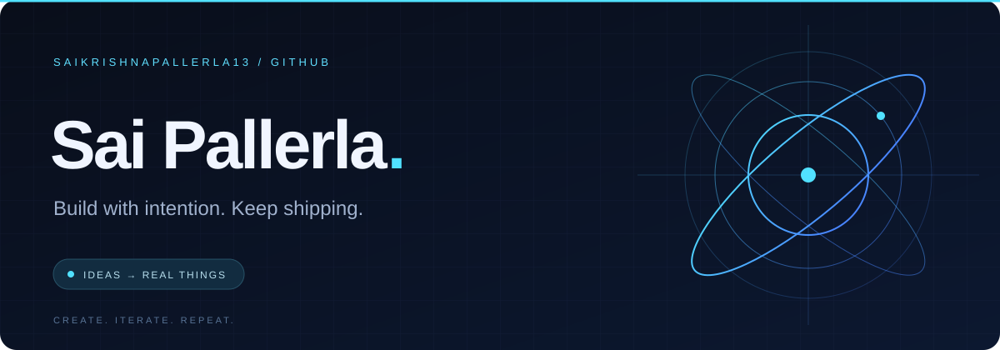

  

  <a href="https://github.com/SaikrishnaPallerla13?tab=repositories"><b>EXPLORE MY WORK ↗</b></a>
  &nbsp;&nbsp; / &nbsp;&nbsp;
  <a href="https://github.com/SaikrishnaPallerla13?tab=overview"><b>ACTIVITY ↗</b></a>

 

### `1 / INTRO`

Hey, I'm **Sai**. This is my corner of the internet for building, experimenting, and turning ideas into working things.

 

### `2 / SELECTED WORK`

| Project | Explore |
| :--- | :--- |
| **Personal portfolio** · My professional portfolio and personal archive. | [Open repository ↗](https://github.com/SaikrishnaPallerla13/sai-pallerla-portfolio) |
| **Cognitive Trace** · JavaScript project. | [Open repository ↗](https://github.com/SaikrishnaPallerla13/cognitive-trace) |
| **Greenlight Landing** · HTML project. | [Open repository ↗](https://github.com/SaikrishnaPallerla13/greenlight-landing) |

 

### `3 / IN THE REPOS`

 
 

---

LESS TALK. MORE BUILDING.

